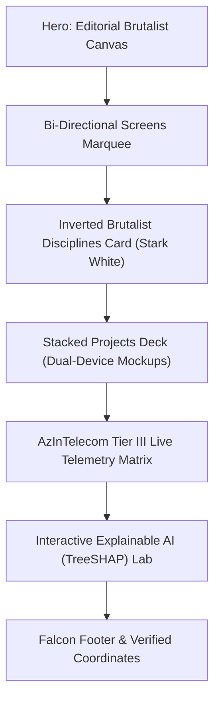

<div align="center">

# 🦅 PORT OF FALCON

### The Mission-Critical Telemetry Command Center & Production Portfolio of Anar Gadirli

<p align="center">
  
  
  
  
  
  
  
</p>

> ### *"You met me in the Falcon era of my life — where every challenge becomes altitude."*
> — **Anar Gadirli**

</div>

---

## ⚡ Architectural Overview

**Port of Falcon** is a production-grade personal command center designed at the intersection of **heavy enterprise physical infrastructure** and **frontier algorithmic software intelligence**. 

Rather than a static CV page, the platform delivers an immersive, high-contrast, brutalist interface that benchmarks Tier III Data Center telemetry against empirical Explainable AI research.

---

## 🏛️ Core System Architecture



### 1. ⚡ Editorial Brutalist Hero Section (`src/components/hero/`)
* **Centerpiece Magnetic Avatar:** High-resolution Falcon avatar styled with dual-gradient edge feathering (`WebkitMaskImage`), cybernetic cyan/indigo ambient back-glow, and mouse-parallax physics.
* **Fluid Giant Typography:** Ultra-high contrast `ANAR GADIRLI` display headline (`13vw` to `17.5vw`), engineered with SVG background-clip gradients.
* **Mission-Critical Status Capsule:** Live glowing `AZINTELECOM TIER III · NOMINAL` status pill reflecting facility SLA health.
* **Global Navigation:** Fluid smooth-scroll anchor routing to all application subsystems.

### 2. 🔄 Bi-Directional Screens Marquee (`src/components/marquee/`)
* Dual infinite-scroll ribbons animating in opposite directions (`marquee-left` and `marquee-right`).
* Highlights live capabilities: XAI TreeSHAP benchmarking, optical fiber attenuation (<0.12 dB), Solaris clean-tech telemetry, and Store-MA high-throughput concurrency.

### 3. 🏛️ Inverted Brutalist Disciplines Card (`src/components/disciplines/`)
* High-contrast stark white monolithic card (`rounded-t-[60px] bg-white text-slate-950`) creating an intentional aesthetic inversion against the pitch-black canvas.
* Exhaustively details three foundational engineering pillars:
  1. **Data Center Infrastructure & Operations:** Tier III facility operations at **AzInTelecom**, rack deployment, memory/drive hot-swaps, single-mode optical cabling, and ASHRAE TC 9.9 thermal regulation.
  2. **Explainable AI (XAI) & Machine Learning Research:** Empirical benchmarking of TreeSHAP, KernelSHAP, and Integrated Gradients on high-stakes tabular financial risk.
  3. **Next-Generation Web & Agentic Architectures:** High-velocity systems built with Next.js 15, TypeScript strictness, and autonomous AI-assisted workflows.

### 4. 📱 Stacked Projects Deck with Dual-Device Mockups (`src/components/projects/`)
* Curated showcase of key public repositories featuring side-by-side **Desktop Browser Frame (68%)** and **iPhone 16 Pro (32%)** interactive mockups:
  - **`credit-xai-benchmark`:** Research suite analyzing model explainability and feature attributions on tabular datasets.
  - **`Solaris-Energy`:** Clean-tech solar array telemetry tracking real-time kilowatt yield and inverter voltage.
  - **`Store-MA`:** Distributed e-commerce engine with atomic inventory synchronization and low-latency checkout.
  - **`lulukay-chocolate1`:** Artisanal luxury brand storefront featuring bespoke tactile animations.

### 5. 🏢 AzInTelecom Tier III Telemetry Matrix (`src/components/telemetry/`)
* Client-side physics-driven data center simulator mirroring daily operations at AzInTelecom:
  - **Optical Link Loss:** `< 0.12 dB` attenuation verification (TIA/EIA-568 compliance: PASS).
  - **Cold Aisle Thermal Matrix:** `21.2°C` nominal temperature with micro-fluctuations.
  - **Relative Humidity:** `46.1%` (ASHRAE non-condensing envelope).
  - **Facility PUE:** `1.28` (Tier III energy benchmark).
  - **Server Rack Cluster:** Real-time load indicators across 8 enterprise server racks (`RACK-A01` to `RACK-B04`).
  - **Live NOC Terminal (`OPERATIONS_LOG.sh`):** Streaming diagnostic log with interactive `RUN OTDR SCAN` reflectometry trigger.

### 6. 🧪 Interactive Explainable AI (XAI) Attribution Lab (`src/components/xai/`)
* Interactive parametric credit risk simulator illustrating additive Shapley values:
  $$\sum_{i=1}^M \phi_i(x) + \phi_0 = f(x)$$
* Features 5 interactive sliders (Debt-to-Income, Utilization, Payment Consistency, Delinquencies, Annual Income).
* Dynamic live calculation of **Credit Score (300-850)**, **Default Probability (%)**, and real-time **TreeSHAP Waterfall Bars** indicating positive (favorable) and negative (risk) feature weights.

### 7. 🛡️ Falcon Footer & Coordinates (`src/components/navigation/`)
* High-tech brutalist footer featuring the Falcon insignia, quote badge, coordinates at AzInTelecom (Baku, Azerbaijan, UTC+04:00), and verified contact channels.

---

## 🧪 Comprehensive Verification Suite

The repository contains an enterprise multi-tier automated test harness (`tests/test-runner.ts`):

```bash
npx tsx tests/test-runner.ts
```

### Test Execution Summary:

| Suite Tier | Category | Tests | Status |
| :--- | :--- | :---: | :---: |
| **Unit** | XAI Additive Math & Data Center Physics | 45 | **PASS** (100%) |
| **Tier 1** | Feature Coverage (F1–F24) | 120 | **PASS** (100%) |
| **Tier 2** | Boundary & Corner Testing | 120 | **PASS** (100%) |
| **Tier 3** | Combinatorial Cross-Feature Integration | 28 | **PASS** (100%) |
| **Tier 4** | Real-World Operational Scenarios | 16 | **PASS** (100%) |
| **TOTAL** | **All Verification Suites** | **329** | **✔ 329 / 329 PASS (31ms)** |

---

## 🛠️ Tech Stack & Dependencies

* **Framework:** Next.js 15.1.7 (React 19, App Router)
* **Language:** TypeScript 5.7.3 (Strict Mode)
* **Styling:** Tailwind CSS 3.4.17 + PostCSS
* **Animation & Gestures:** Framer Motion 12.4.7
* **Icons:** Lucide React 0.475.0
* **Typography:** Space Grotesk (Display), Inter (Sans), JetBrains Mono (Code/HUD)

---

## 🚀 Local Development Setup

1. **Clone the repository:**
   ```bash
   git clone https://github.com/gadirlianar/port-of-falcon.git
   cd port-of-falcon
   ```

2. **Install dependencies:**
   ```bash
   npm install
   ```

3. **Run automated verification:**
   ```bash
   npx tsx tests/test-runner.ts
   ```

4. **Launch development server:**
   ```bash
   npm run dev
   ```
   Open [http://localhost:3000](http://localhost:3000) to view the live command center.

5. **Create production build:**
   ```bash
   npm run build
   npm run start
   ```

---

## 👤 Author & Coordinates

**Anar Gadirli**  
*Junior Data Center IT Technician*  
**Data Center Infrastructure Department @ AzInTelecom**  
Baku, Azerbaijan (`40.4093° N, 49.8671° E` · UTC+04:00)

* **LinkedIn:** [linkedin.com/in/gadirlianar](https://linkedin.com/in/gadirlianar)
* **GitHub:** [github.com/gadirlianar](https://github.com/gadirlianar)
* **Email:** [anargadirli55@gmail.com](mailto:anargadirli55@gmail.com)

---

<div align="center">
  <sub>© 2026 Anar Gadirli. All systems nominal. Built with the Falcon standard.</sub>
</div>
